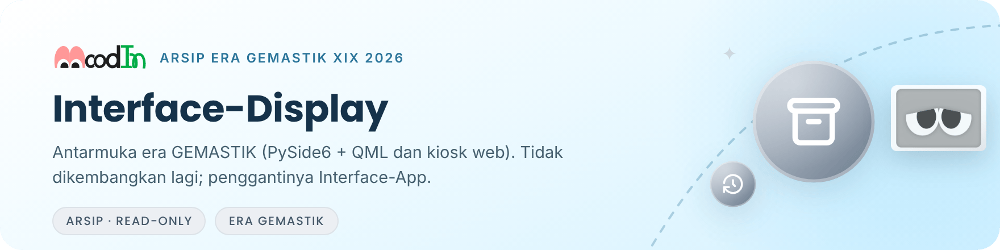

<picture>
  <source media="(prefers-color-scheme: dark)" srcset=".github/readme/banner-dark.png">
  
</picture>

> [!WARNING]
> **Repositori ini diarsipkan dan bersifat _read-only_ sejak tahap Proposal Tugas Akhir (Pra-TA).** Antarmuka MoodIn kini dibangun dengan Flutter di [Interface-App](https://github.com/MoodInBME/Interface-App). Isi repositori ini tidak dikembangkan lagi dan tidak mengikuti kontrak pesan v2.

Interface-Display adalah antarmuka pertama MoodIn, dibuat oleh tim VisionaryX untuk GEMASTIK XIX 2026. Aplikasinya berjalan sebagai kiosk di balik cermin dan memandu pengguna dari layar sapaan sampai hasil pemeriksaan. Repositori ini disimpan sebagai rujukan sejarah dan sumber prinsip desain bagi Interface-App.

Repositori ini bagian dari proyek [MoodIn](https://github.com/MoodInBME/MoodIn-master). Isinya sama dengan tag [`gemastik-xix-2026`](https://github.com/MoodInBME/Interface-Display/tree/gemastik-xix-2026), ditambah pembaruan README ini, gambar README di `.github/readme/`, dan catatan arsip di `AGENTS.md`.

## Isi repo

| Bagian                  | Isi                                                                                                     | Catatan                                                      |
| ----------------------- | ------------------------------------------------------------------------------------------------------- | ------------------------------------------------------------ |
| `src/moodin_interface/` | Aplikasi kiosk PySide6 + QML: layar idle, persetujuan, perekaman, hasil, tren, dan pengaturan           | Memakai kontrak pesan v1.1.0                                 |
| `web/`                  | Prototipe kiosk web (React + Vite) untuk layar _portrait_ 600×1024, termasuk layar Home Tamu dari Figma | Snapshot 8 Agustus 2026, belum diuji                         |
| `devkit/`               | Simulator MQTT untuk mengembangkan UI tanpa model (`tools/dev_simulator.py`)                            | —                                                            |
| `docs/`                 | Kontrak pesan v1.1.0 versi repo ini dan peta layar                                                      | Berbeda dari kontrak v1.0.0 di MoodIn-master                 |
| `tests/`                | Uji kontrak, basis data, dan _state machine_                                                            | —                                                            |
| `web/public/assets/`    | Aset SVG maskot dan ikon _mood_                                                                         | Boleh dipakai ulang di Interface-App dengan mencatat asalnya |

## Prinsip UI yang masih relevan untuk Interface-App

<table>
  <tr>
    <td width="50%" valign="top">
       
      <b>Jangan menampilkan angka basi</b> 
      Bila jalur fisiologis tidak tersedia, sembunyikan kartu tanda vital; jangan tampilkan nilai terakhir. Hasil dari jendela pengukuran yang belum penuh juga tidak ditampilkan; tampilkan indikator kemajuan.
    </td>
    <td width="50%" valign="top">
       
      <b>Mode demo selalu ditandai</b> 
      Mode demo atau simulasi wajib diberi penanda yang selalu terlihat.
    </td>
  </tr>
  <tr>
    <td width="50%" valign="top">
       
      <b>Kontras tinggi di balik cermin</b> 
      Gunakan latar gelap dan kontras tinggi untuk tampilan di balik cermin dua arah, dan hindari elemen sentuh yang menuntut presisi.
    </td>
    <td width="50%" valign="top">
       
      <b>Angka, bukan gambar</b> 
      UI tidak menerima citra wajah; hanya nilai numerik.
    </td>
  </tr>
</table>

## Lisensi

LGPL-3.0-or-later, mengikuti PySide6. Lihat [LICENSE](LICENSE). Dibuat oleh tim VisionaryX, Institut Teknologi Sepuluh Nopember, untuk GEMASTIK XIX 2026.

---

Departemen Teknik Biomedik · Fakultas Teknologi Elektro dan Informatika Cerdas (FTEIC) 
Institut Teknologi Sepuluh Nopember · Surabaya, Indonesia

  
Ikon antarmuka: <a href="https://tabler.io/icons">Tabler Icons</a> (MIT), lihat <a href=".github/readme/KREDIT.md">kredit aset</a>. Maskot: desain tim MoodIn era GEMASTIK.

